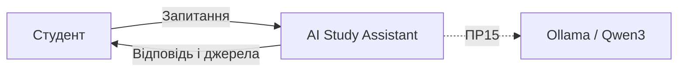
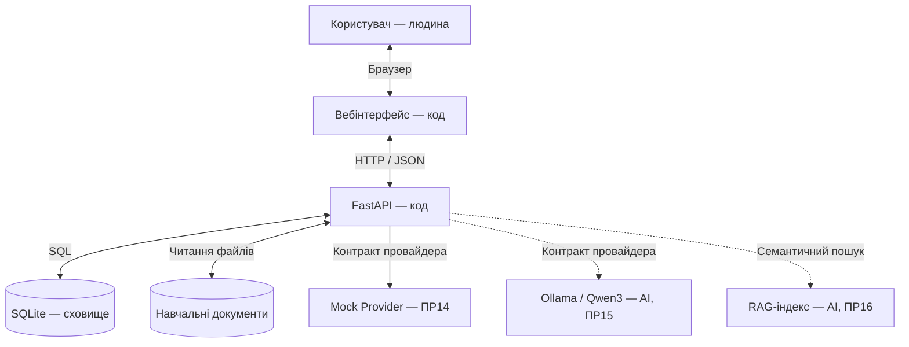

# Архітектура AI Study Assistant

## 1. Контекстна схема

## 2. Контейнерна схема

Суцільні стрілки — компоненти ПР14.
Пунктирні стрілки — майбутні компоненти.

## 3. Шари сервера

| Шар | Файл | Призначення |
|---|---|---|
| Контролер | app/main.py | HTTP-маршрути |
| Сервіс | app/service.py | Логіка сценарію |
| Оркестрація | app/orchestration.py | Контекст і перевірка AI |
| Шлюз | app/gateway.py | Виклик провайдера |
| Контракт | app/providers/base.py | Інтерфейс AI |
| Mock | app/providers/mock.py | Тестові відповіді |
| Сховище | app/storage.py | SQLite і документи |
| Конфігурація | app/settings.py | Налаштування |
| Журнал | app/telemetry.py | Логування |

## 4. Межа між AI, кодом і людиною

Людина:
- вводить запитання;
- перевіряє результат.

Код:
- перевіряє вхід;
- читає документи;
- керує запитами;
- зберігає результати;
- перевіряє формат відповіді.

AI:
- у ПР15 формуватиме відповідь;
- у ПР16 використовуватиме семантичний пошук.

У ПР14 поведінку AI імітує mock-провайдер.